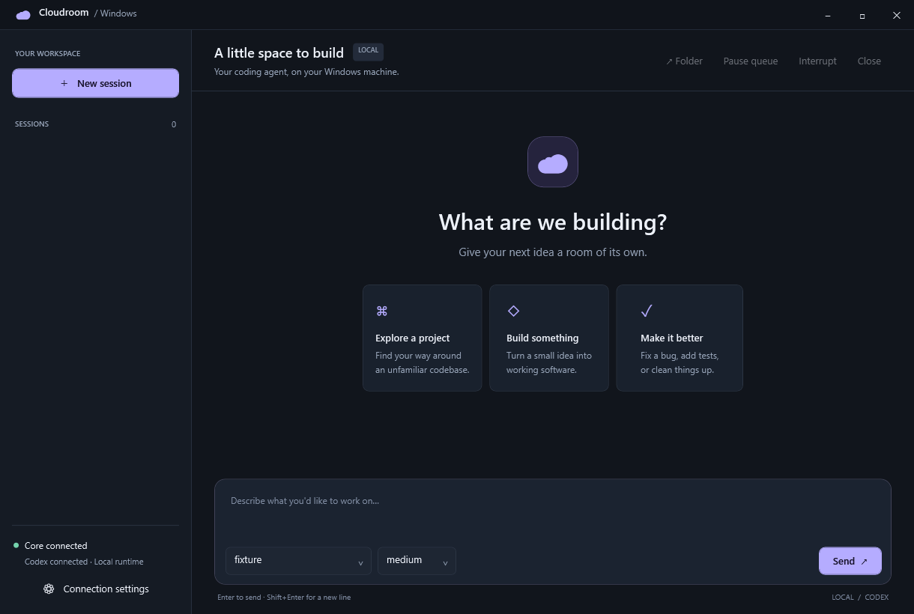

# Cloudroom core

## Native Windows port (alpha)

The [original desktop Windows preview](docs/windows-parity.md) builds from our separate GUI fork and remains a reference application. **Cloud Bee is our primary native WPF GUI.** Use `Start-Cloud-Bee.cmd`; `Start-Cloudroom-Preview.cmd` opens the separate original preview.

The `windows-native` branch adds a native `cloudroom.exe` backend, a **Windows desktop GUI**, and a PowerShell launcher. Codex sessions, live conversation output, model selection, project folders, saved history, restart recovery, and Job Object process cleanup are available.

This is a **single-user, localhost-only runtime**: agents share your Windows account. Terminals, other harnesses, command guards, sync, and Linux security isolation still need porting.

**Cloud Bee** is our native Windows WPF application. It adds separate Chat/Work modes, reviewed context handoffs, durable conversations and a cross-provider Council with coordinated research and Hive Traffic Control for reviewed native Work. See the [Cloud Bee guide](docs/cloud-bee.md) for capabilities, API setup and limitations.

See [Council and Hive Traffic Control](docs/hive-traffic-control.md) for model selectors, microtasks, isolated Git worktrees, resource leases, reviewed single-file integration and recovery. Native Codex is the first supported coding worker; Chat participants cannot modify files.

Cloud Bee also includes [native Automations, Custom instructions, and Keep Awake](docs/native-extensions.md), with durable run history and plugin controls.

Native [Docs, Memory, Tasks and conversation organization](docs/native-library.md)
add private content, scoped message context, task status, saved names, pins,
collections, search and archive/restore. Full parity remains in progress; the
[function checklist](docs/cloudroom-feature-parity.md) tracks all 35 bundled
original plugins and the remaining desktop workflows.

[Native Markdown and workspace files](docs/native-files.md) add selectable rich
conversations, basic code coloring, file links, bounded text editing, revision
conflict checks, side-by-side comparison and private recovery copies.

See the [Windows setup guide](docs/windows.md) and [desktop build guide](integrations/windows/README.md) for installation, supported features, limitations, and tests. Double-click `Start-Cloud-Bee.cmd` to launch, or run `install\create-shortcut.ps1` to add a desktop shortcut. The upstream Linux documentation follows below.



[Website](https://www.cloudroom.dev) · [Desktop app](https://github.com/davidondrej/cloudroom-gui) · [Changelog](https://www.cloudroom.dev/changelog) · [Security](https://www.cloudroom.dev/security)

Your agents get their own room in the cloud.

Cloudroom core runs coding agents on your own Linux machine and saves their chat history. It powers the cloud side of the [Cloudroom app](https://github.com/davidondrej/cloudroom-gui), which runs Claude Code, Codex, and Pi on your Mac or in the cloud.

- Works with Codex, Claude Code, Pi, and Cursor.
- Agents use your own logins to call their models.
- One Rust service per machine. No Cloudroom account needed.

Don't want to host it yourself? Hosted Cloudroom is invite-only for now. [Join the waitlist](https://www.cloudroom.dev/#waitlist).


## Get started

- [Native Windows local runtime](docs/windows.md): Codex backend for one trusted Windows user, with a PowerShell launcher (initial port; see platform limitations).
- [Install on Ubuntu 24.04](docs/setup.md) with one script, on a VPS, a home server, or a spare laptop. A database on the same machine works.
- [Reach it from your laptop](docs/setup.md#reach-it-from-your-other-devices) with Tailscale, and [upgrade](docs/setup.md#upgrade) in place.
- [HTTP API](docs/api.md): every endpoint, event, and error code.
- [Linux builds](https://github.com/davidondrej/cloudroom-core/releases): tested binaries for each release.

## Security

- Agents run as a separate Linux user, with no admin rights and no `sudo`.
- Agents can't read the core's token, database password, or history files.
- Every API request needs a secret token. The API listens only on localhost unless you put it behind HTTPS.
- History is saved to PostgreSQL: on the same machine, or on another one over verified TLS.
- Command Guard blocks a few disastrous commands, like wiping a home folder.

Agents run without approval prompts, so give each trusted user their own machine.
Report vulnerabilities privately: see [SECURITY.md](SECURITY.md).

## Desktop app

[Download the Cloudroom app](https://github.com/davidondrej/cloudroom-gui/releases) for Apple Silicon Macs (Linux alpha). [Connect it to your own core](docs/setup.md#connect-the-desktop-app) with a URL and token, no account needed. The core also works without it.

## Build and test

Needs Rust 1.89+, Git, and the agent CLIs you want to run.

```sh
cargo build --locked --release
cargo test --locked --all-targets
```

Apply the two SQL files in `docs/database/` to a dedicated PostgreSQL database. The core never runs migrations itself.

More docs: [storage](docs/storage.md) · [harnesses](docs/harnesses.md) · [session lifecycle](docs/session-lifecycle.md) · [diagnostics](docs/observability.md) · [dashboard API](docs/dashboard.md)

## Contributing

Issues and pull requests are welcome. For big changes, open an issue first.
This is pre-release software. Licensed under [Apache 2.0](LICENSE).
