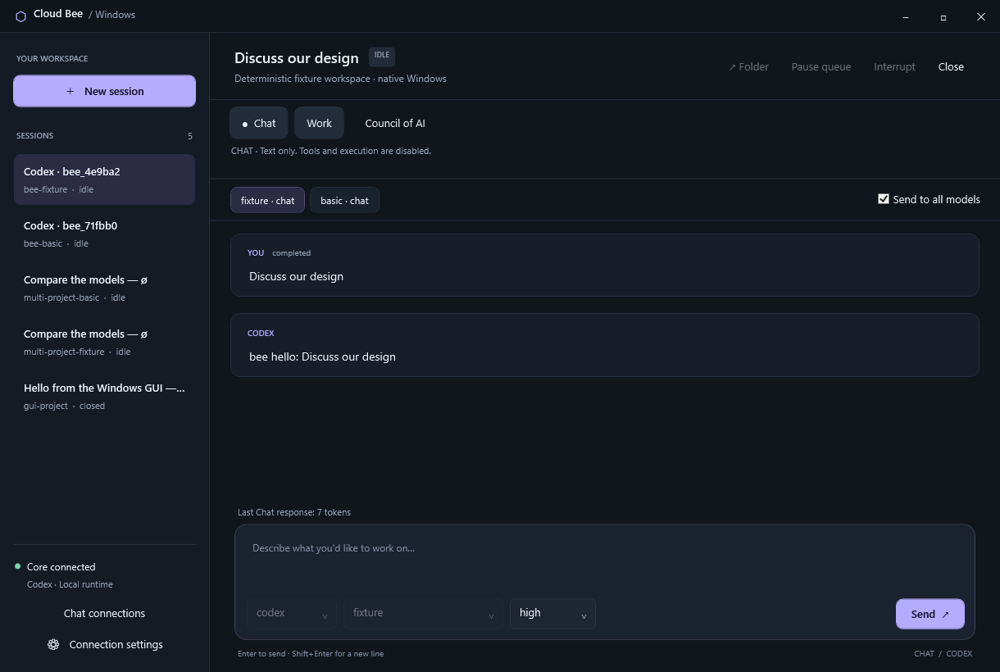
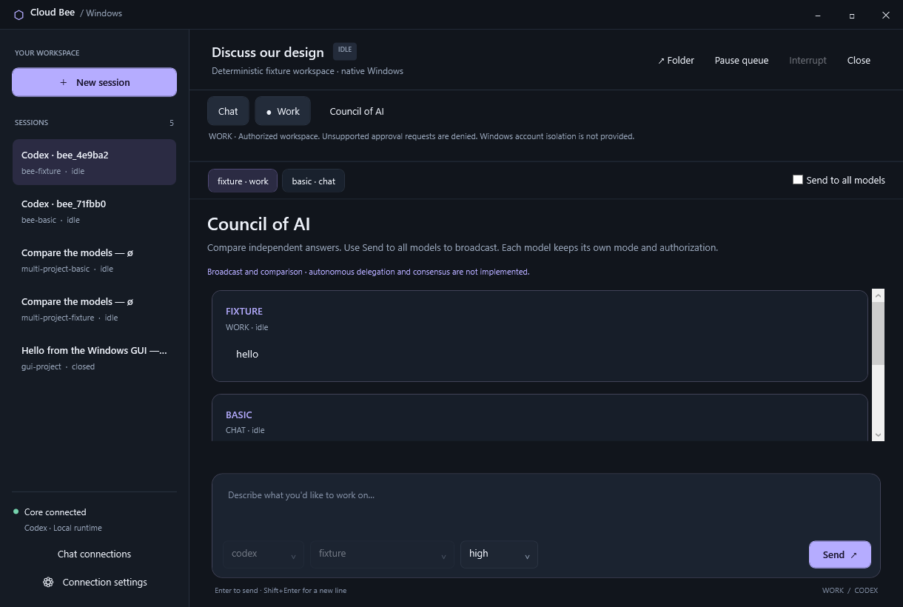

# Cloud Bee for native Windows

Cloud Bee keeps our WPF desktop and uses Cloudroom Core's Rust service. It is a
Windows fork of [Cloudroom](https://github.com/davidondrej/cloudroom-core), not a
claim of complete parity with the original Electron application.

## Launch and use

Double-click `Start-Cloud-Bee.cmd`, or run:

```powershell
powershell.exe -NoProfile -ExecutionPolicy Bypass -File "D:\Cloudroom\install\windows.ps1" -Action Gui
```

`install/create-shortcut.ps1` creates **Cloud Bee** on the desktop. Existing
Cloudroom launchers and private `%LOCALAPPDATA%\CloudroomCore` settings remain
compatible; no history or credentials are moved during the rename.

1. Open **Chat connections**. Choose OpenAI API, xAI API, or a local
   OpenAI-compatible server and an exact model ID. Local endpoints require a
   numeric loopback address, for example `http://127.0.0.1:11434/v1/chat/completions`.
   This does not install or start a local model server.
2. Create a conversation, optionally selecting additional models for the Council.
   New conversations begin in Chat view; creating one never starts an agent.
   Chat stays unavailable until its own API profile is configured.
3. Select **Work**, review the objective, context, approved requirements, workspace,
   constraints, acceptance criteria and artifact references, then explicitly
   authorize it. Work initially supports exact models in the native Codex catalog.
4. Send a task and inspect its transcript. Select **Chat** to review a result handoff
   without terminating background Work. **Interrupt** cancels its active turn.
   Model tabs retain their own modes. **Close** closes the conversation and its Work.
5. **Council of AI** compares each selected model's latest response. **Send to all
   models** broadcasts once per participant, using each participant's selected
   mode and existing authorization. Untick it to message the selected model only.

Council currently provides broadcast and comparison within a group of models
from one harness. It does not implement autonomous delegation, voting, consensus,
cost-based routing, or automatic cross-provider orchestration. A failed delivery
reports its recipients; retry the unchanged message to reuse their original IDs.

## Capabilities and security

| Integration | Chat | Managed Work |
| --- | --- | --- |
| OpenAI model / Codex | Separate OpenAI API profile | Native Codex catalog models |
| Grok | Separate xAI API profile | Unavailable |
| Local compatible server / Qwen | Explicit local HTTP profile | Unavailable |
| Claude / Anthropic | Not integrated into this native slice | Unavailable |

OpenAI and xAI API credentials/billing are distinct from consumer subscriptions.
Codex and Grok CLI logins are not extracted to make Chat calls. A profile is
configuration, not proof that a particular model/account is accepted by the API.
There is no provider or model fallback. Native Grok/Qwen sessions from existing
work remain accessible; starting a new legacy session requires the separate
legacy authorization checkbox. Legacy sessions retain their original permissions
and cannot be relabeled as tool-free Chat.

Chat uses a dedicated HTTP adapter with **no tool dispatcher**, no supplied tools,
and `tool_choice: none`. Tool-call responses are rejected, never executed. It
cannot browse or perform research actions; it can discuss supplied information.
OpenAI's [Chat API contract](https://developers.openai.com/api/reference/resources/chat/subresources/completions/methods/create)
and xAI's [compatible API](https://docs.x.ai/developers/rest-api-reference/inference/chat-completions)
are the transport references. Local server behavior depends on that server; Cloud
Bee still has no executable tool path for its responses.

Managed Work requests Codex `workspace-write` and `untrusted` approval policy,
including recovery and rewind. Approval interactions unsupported by Core fail
closed. There is currently no interactive approval dialog to authorize escalations;
consequential requests needing approval remain blocked. Workspace selection is
limited to Core's configured repository or registered project folders.
**Windows account isolation is not provided.** These protocol policies and Job
Object lifetime management are not a security sandbox or a guarantee that an
untrusted same-user process cannot reach personal files or credentials.

Handoffs are compact, user-reviewed records, not full transcript copies. The dialog prefills a bounded excerpt of recent discussion and the latest answer without making an inference call. No model
calls occur merely for tab/mode switching or automatic summarization. Work receives
each reviewed handoff once, on its next prompt. Return-to-Chat summaries and
artifact references are reviewed text; tool output is excluded from prefills.
Known Core/API credentials are redacted from handoffs and Chat output. This is not
a general secret detector: keep unrelated credentials out of handoff text.

## Persistence and verification

Each conversation under `CLOUDROOM_STATE_DIR/bee/` records its shared identity,
provider/harness/model, mode, Council group, workspace, linked native session,
handoffs, immutable request payloads, Chat history/status and provider token usage.
Native Work histories stay in the existing Core journal. Chat exposes the last
response's token count in the GUI. Desktop outbox files beside `core.json` preserve
pending starts, messages and drafts across reconnect/restart, scoped to the Core
connection identity. Nothing is resent automatically merely by opening the GUI.

API keys live only in private `bee/profiles.json`, never in capabilities, handoffs,
process arguments or logs. Files inherit the Windows state directory's ACL; the
launcher restricts its data root to the user and SYSTEM. Use the launcher-managed
private directory. Back up all Core data while stopped and never publish those
files or desktop outboxes. Uncertain Chat after Core restart stays marked unknown;
it is never automatically retried. Inspect history before issuing a new request.

Validation uses disposable HTTP/Codex fixtures, with no paid inference:

```powershell
cargo fmt --check
cargo clippy --locked --all-targets -- -D warnings
cargo test --locked --all-targets
python tests/windows_native.py
python tests/windows_bee.py
python tests/windows_launcher.py
python tests/windows_gui.py
```

The WPF smoke includes lost-response recovery through the persisted outbox, project
creation, existing multi-model sends, Chat/Work switching, independent modes,
Council comparison and reconnect. Backend checks cover tool-call rejection,
authorized fixture tool execution, background cancellation, handoff delivery,
capabilities, restart without replay and credential redaction. These prove the
contracts against fixtures; live API inference, native Codex permission enforcement
against real tools, and every Grok/Qwen behavior are not certified by these tests.




Remaining original-app parity includes Plugins/Skills management, local
Automations, richer project/worktree management, cloud coordination, interactive
approvals and additional provider adapters. See [the parity checklist](windows-parity.md).
