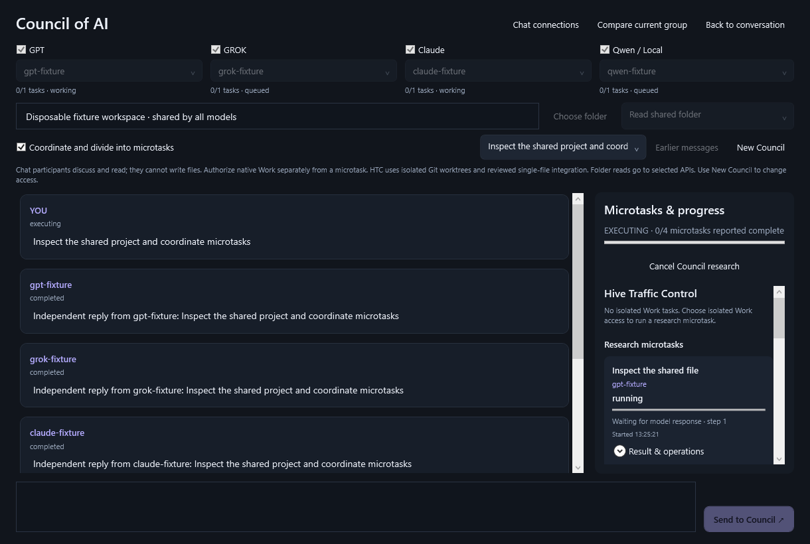
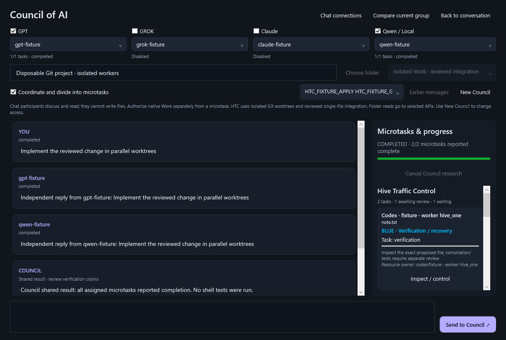

# Council and Hive Traffic Control (Windows v1)

Cloud Bee keeps its native WPF interface and one Rust Core service. Open **Council**
to select GPT, Grok, Claude, and Qwen/local models in one row. Configure exact model
IDs and API credentials in **Chat connections** first. Anthropic uses its Messages
API; Qwen supports an explicitly selected Alibaba Model Studio regional endpoint.
API accounts/billing are separate from consumer subscriptions and native CLI logins.

Every enabled participant receives the same message. With **Coordinate and divide
into microtasks**, the first participant creates a bounded dependency plan. Core
validates it and runs independent research tasks concurrently, including multiple
tasks for one model. Dependency results reach subsequent tasks; a final response
combines their findings. Progress reflects saved states, operations, steps, and
completion counts. Model-reported research completion is not independent verification.
**Compare current group** retains the earlier independent-response comparison for
existing conversation groups.

## Run isolated coding work

1. Choose a local **Git project root** and **Isolated Work · reviewed integration**
   access when creating a Council. Discussion is the default; read access permits
   bounded UTF-8 previews. Folder contents may be sent to the selected APIs.
2. Send a coordinated request. Select **Run isolated Work…** on a research microtask.
   Choose an installed native Codex model and one existing tracked UTF-8 file.
   Review the scope and authorize execution. The source Git project must be clean.
3. Core creates a detached Git worktree and starts an owned native Work session
   there. Up to four workers can execute concurrently, including several instances
   of the same model. The research participant and coding worker are separate
   identities. **API Chat participants cannot write files**, even under Work access.
4. **Inspect / control** opens ownership, queue position, lease times/generation,
   native session ID, preserved worktree path, baseline, proposed file, and checks.
5. After execution, Core closes the entire owned native Job before offering review.
   Inspect the exact proposal and required checks, check the review box, and choose
   **Approve integration** or **Reject**. HTC applies only that stored file proposal.
   Other modifications remain in the preserved worktree.

This first slice supports **native Codex Work and one existing tracked UTF-8 file
per integration**, at most 256 KiB including any UTF-8 BOM. It does not merge whole
branches, accept arbitrary artifacts, integrate new/deleted files, run project
tests automatically, or grant Claude/Grok/Qwen API models native execution.
Users review compilation/testing evidence separately; the inspection window says
which deterministic checks Core performs. Automatic plan-to-execution delegation,
additional native Work providers, multi-file proposals, and verified branch merges
remain future work.

## Resource state and task state

| Traffic | Authoritative resource state |
| --- | --- |
| GREEN · Available | No conflicting reservation or held lease |
| YELLOW · Reserved / waiting | A reservation is held or queued for conflicting ownership |
| RED · Modifying | A private worktree is being prepared/modified, or reviewed shared integration is writing |
| BLUE · Verification / recovery | A stopped proposal awaits acceptance, or interrupted ownership requires reconciliation |

The task state appears separately. For example, a waiting task can display BLUE
for the shared file because another task owns its verification lease. Queue
position identifies the waiting request. A failed task can retain BLUE recovery
ownership. An integrated task can show another task's current shared-file owner.
Private worktree modification and shared-file integration have separate resources.
The GUI uses text and color; indeterminate bars indicate activity, not invented
percentages. Polling ownership does not make model calls.

## Enforced by Core

`src/session/extensions/traffic.rs` owns durable task state, action identities,
resource metadata, and the lease engine. `traffic/leases.rs` performs deterministic
arbitration. `traffic/worker.rs` owns Work and reviewed integration; `traffic/git.rs`
runs bounded, Job-owned Git helpers with hooks/fsmonitor disabled. No extra service,
SQL tables, or production database migrations are introduced.

* Canonical local Windows paths, case-normalized physical keys, capability-relative
  path resolution, and directory/file overlap checks prevent aliases/traversal from
  bypassing application coordination. Resource IDs are not authorization.
* Resource sets are sorted and acquired atomically. Incremental hold-and-wait is
  denied. Earlier conflicting waiters take priority; independent resources proceed.
  Queued reservations expire after two minutes. Retries are explicit and bounded
  to three attempts. A preserved queued proposal can be requeued without inference.
* Each lease has a cryptographically random ownership token, monotonic generation,
  owner agent/session/task, acquisition/expiry/heartbeat times, and phase. Tokens
  stay inside Core. Core renews owned live leases; expiration fences the old
  generation and retains recovery ownership, rather than assuming a writer died.
* State mutations copy, serialize, sync, and replace the authoritative private file
  before publishing the new state. Native session startup also uses the existing
  durable journal. An exclusive Windows state handle is acquired before journal
  recovery, so another Core cannot mutate the same data directory. Completed requests retain their outcomes; changed accepted payloads and stale
  task revisions are rejected. Interrupted integration requires reconciliation,
  rather than replay. GUI pending requests persist
  privately across reconnect and require explicit retry.
* Integration requires stopped owned execution, current lease/token/generation,
  unchanged source Git HEAD and baseline SHA-256, the reviewed proposal digest,
  and explicit human approval. It uses the existing exclusive Windows file handle,
  revision-checked save, hard-link rejection, and before/after recovery journal.
  The save mutex also fences other Core file edits against held HTC ownership.
* Two proposals based on the same file revision cannot silently replace one
  another: the first accepted write changes that revision and the second is rejected.

## Pause, cancel, crash and recovery

**Pause** stops the owned execution and retains its worktree. It does not claim
Windows process freezing. **Cancel** likewise waits for owned execution termination
before releasing ownership. **Retry preserved Work** starts a fresh explicit native
attempt in the retained worktree; it never replays the old native request identity.
Rejecting a stopped proposal releases its coordination while keeping its contents.

On Core restart, held leases receive new generations and enter recovery; queued
requests are not automatically replayed. HTC native sessions are excluded from
the normal conversation auto-resume behavior. A live old writer keeps ownership;
Core retains the native Job handle while running and checks its active-process
count, including descendants, before releasing ownership. Recovery also checks
the recorded Core-process and native-process creation identities; a reused PID
is never killed. Unconfirmed termination retains recovery ownership. After a
Core crash, the non-inheritable kill-on-close Job terminates its processes, as
described by [Microsoft's Job Object contract](https://learn.microsoft.com/en-us/windows/win32/procthread/job-objects).
HTC-owned sessions are not automatically resumed.

For BLUE recovery, inspect the worktree, proposal/baseline, current shared file and
file-save history. **Keep current disk / release recovery** requires explicit review,
confirmed owned execution termination, and the current file revision. It keeps the
file exactly as inspected; it does not accept an old proposal or silently roll back
a partial write. Use the existing file editor/recovery drafts if a manual restoration
is needed. Uncertain in-place integration remains recovery work; restart never
reapplies it. No unfinished worktrees are automatically deleted.

## Cooperative boundary and limits

Native processes share the Windows user's account. Git worktrees, Core leases,
`workspace-write`/`untrusted` Codex policy, and Job ownership **do not provide OS
account isolation**. A same-user process can bypass application APIs, alter Git
metadata, or write directly to other folders. HTC serializes Core-mediated
integration and detects baseline changes; it cannot make arbitrary external Git
operations transactional or secure untrusted native code. Shared concurrent editing
is not enabled by default. Ordinary independent Chat remains tool-free; Council
research adds only bounded, scoped file reads/listing, with all file writes denied.

V1 retains at most 200 Work tasks, 2,048 registered resources, 4,096 reservations
and 4,096 action receipts. Reaching a limit fails explicitly. Preserve the private
Core data directory and unfinished worktrees before any manual archival. There is
no automatic worktree deletion, history discard, or lock override against a writer.

## API and verification evidence

The existing Bearer-authenticated localhost API exposes:

* `GET /v1/bee/councils/catalog`, `GET/POST /v1/bee/councils`
* `GET /v1/bee/councils/{id}` (paged history), `POST /{id}/messages`, `POST /{id}/cancel`
* `GET /v1/bee/traffic`, `GET /v1/bee/traffic/catalog`
* `POST /v1/bee/traffic/tasks`, `GET /v1/bee/traffic/tasks/{id}`
* `POST /v1/bee/traffic/tasks/{id}/{pause|cancel|retry|approve|reject|recover}`

Lease acquisition/renewal/release are internal trusted operations, not model-facing
authorization endpoints. A task creation request names a saved Council/round/
microtask, native model, target path and explicit authorization. Mutations use
immutable `request_id`; controls require `expected_revision`; approval additionally
requires the stored `proposed_revision`, and recovery the inspected `current_revision`.

Deterministic Rust tests cover same-resource exclusion, independent acquisition,
directory overlap, atomic sets/deadlock prevention, expiry/stale generations,
duplicates, simultaneous callers, Chat denial, Windows path aliases, durable state,
and restart fencing. `tests/traffic_fixture.py` exercises real Windows-owned native
processes, disposable Git worktrees, parallel workers, integration queues, stale
baselines, verification rejection, guarded-save hard-link failures with immediate
recovery fencing, cancellation preservation and restart reconciliation.
`tests/windows_gui.py` exercises the actual WPF panel, proposal controls, saved
backend states and lost-acceptance retries. Provider/native fixtures spend no model
tokens. Required Rust checks and the native launcher/Bee/extensions/GUI suites must
pass on the exact public source before packaging.

## Native WPF fixture views

These screenshots use local deterministic providers and disposable Git projects.

