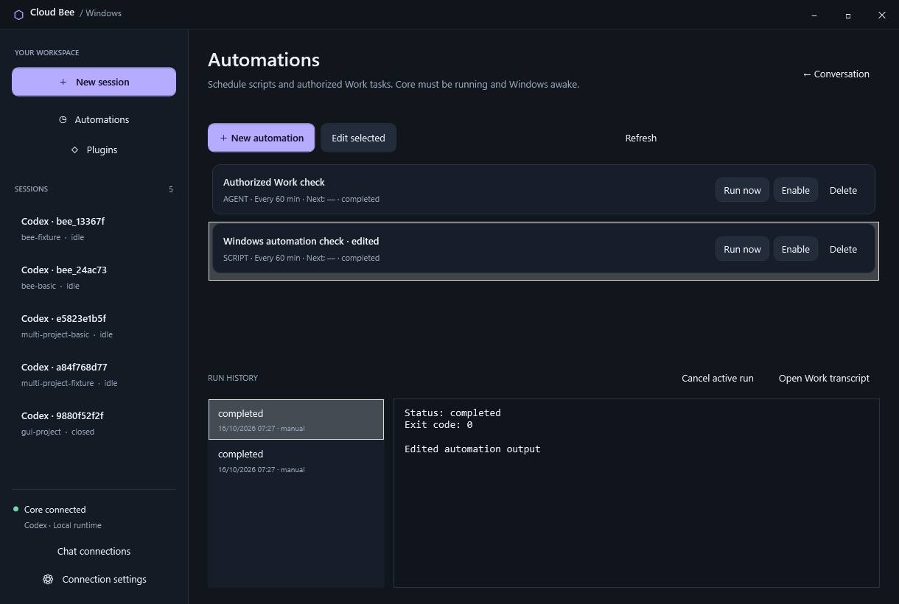
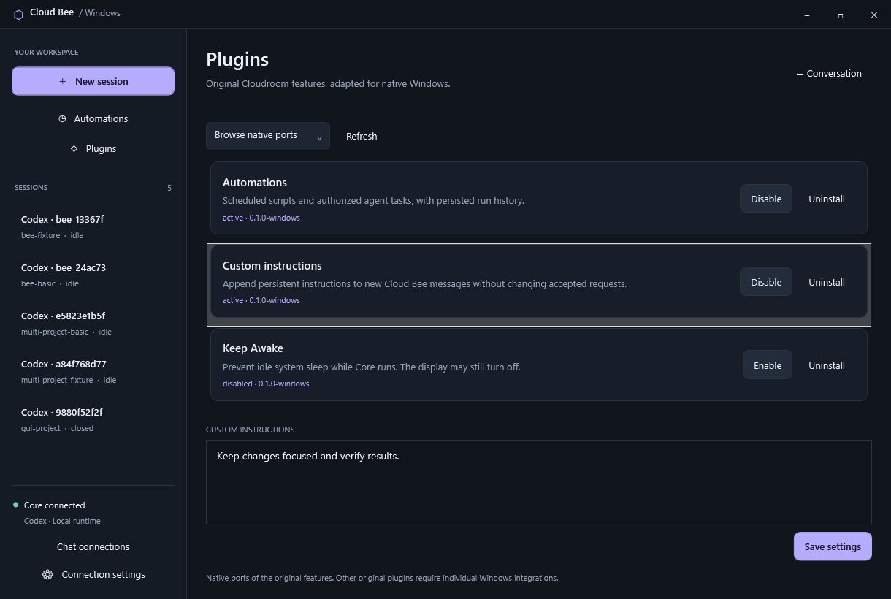

# Automations and Plugins in Cloud Bee

Cloud Bee keeps its WPF GUI and ports three original Cloudroom features into
the existing Rust Core: **Automations**, **Custom instructions**, and **Keep Awake**.
Use the new sidebar buttons. These are native ports of the original features;
the general TypeScript/React plugin SDK and original marketplace packages are
not binary-compatible with this runtime.

## Automations

Select **Automations → New automation**, then review the task and its workspace:

- Scripts: PowerShell, Node.js (CommonJS), or Python. The selected interpreter
  must already be installed. Windows PowerShell 5.1 receives UTF-8 source and
  output; no global execution policy is changed.
- Agent tasks: use the ID of an already-authorized Cloud Bee Work conversation.
  Select Work before creating the automation. The saved native Work identity
  remains its target even when you later switch the GUI to Chat.
- Schedules: every N minutes, a one-shot ISO date with an offset, or a numeric
  five-field cron expression with an IANA timezone such as `Europe/Oslo`.
  For weekdays at 09:00 use `0 9 * * 1-5`. Numeric lists, ranges and steps are
  supported; named months/days, `L`, `W`, `#`, and seconds fields are not.

Saving or changing execution requires the authorization checkbox. Scripts have
the Windows account's permissions; a workspace and Job Object do not provide
account isolation. No credentials are injected into script environments. Agent
tasks retain the native Work session's permission policy; Chat never gains tools.

Use **Run now**, **Pause/Enable**, **Edit selected**, **Delete**, and **Cancel active
run**. Pause prevents future scheduled runs while leaving an active run alone.
Cancel interrupts the active agent prompt or terminates the script's owned Windows
process tree. Deleting an automation hides it from the active list while retaining
its run history. Uninstalling the Automations plugin requires active runs to finish
or be cancelled. Disabling it pauses dispatch and retains schedules and history.

Run history shows status, start time, script output, errors, and exit code. Agent
runs link their existing native transcript through **Open Work transcript**, so
queued turns cannot cause another task's output to be mistaken for this run. Scripts have
a 1–600 second timeout; stdout and stderr each retain up to 64 KiB. Extra output is
drained and marked truncated. Each run gets a private immutable source copy.
Updates apply to subsequent runs; existing runs and history retain their snapshots.

Local schedules require Core to be running and Windows awake. Closing only the
GUI leaves Core and its schedules running. Missed occurrences are coalesced into
one due run on restart, with future runs calculated from the current time. Runs
claimed before a restart remain **unknown after restart** and are never replayed.
At most one run per automation and four runs in total can be active. Run IDs and
request ledgers prevent duplicate dispatch after retries, including retained history
cleanup. The last 100 runs per automation are retained.

Cron matches real UTC instants converted through the IANA timezone database:
nonexistent spring-forward wall times are skipped; repeated fall-back wall times
can match twice. When both day-of-month and day-of-week are restricted, either
matching day qualifies. Recurring failures are recorded and the ordinary schedule
continues; the original plugin's 30/60-second failure retry policy is not ported.
There is no cloud/offline host execution, remote host script transfer, shell/Bash
emulation, fresh worktree creation, original SQLite import, or automatic provider
fallback in this first native port.

## Plugins

**Installed** lists installed native ports. **Browse native ports** includes
available ports that can be installed. Install, enable, disable and uninstall
operations persist across Core and GUI restarts. Uninstall retains settings for
reinstallation and never deletes automation history or project files.

**Custom instructions** adds up to 4096 characters to newly accepted Cloud Bee
messages and new agent automation runs. The text is snapshotted with execution;
edits and retries cannot change previously accepted payloads. Disabling the plugin
stops future additions. Control messages beginning with `/` remain unchanged.
Historical Chat context retains the instructions submitted with those messages.
Instructions cannot grant tools or change Chat/Work authorization. Legacy raw
Core API sessions do not receive this Cloud Bee message hook.

**Keep Awake** uses a Windows thread execution-state request while enabled and
Core is running. Its runtime status shows whether Windows accepted the request.
The display may turn off. Disable/uninstall or Core exit releases the request;
the plugin does not change power plans, prevent explicit user sleep, or guarantee
operation with the laptop lid closed. It is available to install and remains off
until selected. Automations and Custom instructions are installed by default;
Custom instructions initially contains no text.

## Storage, API and validation

Private state lives in `CLOUDROOM_STATE_DIR/extensions/state.json`; immutable
script snapshots live below `extensions/scripts/`. Files inherit the installer's
private Windows ACL. These files contain scripts, instructions and task output:
do not publish them. Known configured Core/API credentials are redacted from
captured output; this is not a general secret detector. Scripts still run as the
same Windows account and can access that account's files.

The existing authenticated, loopback-only API exposes:

These native extension routes and workers are enabled only on Windows. Linux Core
continues to use its existing automation integration and agent-account isolation.

- `GET/POST /v1/bee/automations`
- `GET /v1/bee/automations/{id}`
- `POST /v1/bee/automations/{id}/update|run|pause|enable|cancel|delete`
- `GET /v1/bee/plugins`
- `POST /v1/bee/plugins/{id}/install|enable|disable|uninstall|settings`

Updates use revision checks; mutations use immutable request identities. The
native automation and plugin tests use disposable state, actual local scripts,
and deterministic HTTP/Codex fixtures, with no paid inference:

```powershell
cargo fmt --check
cargo clippy --locked --all-targets -- -D warnings
cargo test --locked --all-targets
python tests/windows_extensions.py
python tests/windows_gui.py
```

Coverage includes authorization, instruction snapshots, Windows power requests,
script interpreters/Unicode, agent targeting, schedules, history, timeouts/output
bounds, descendant cancellation, restart without replay, editing conflicts, plugin
lifecycle, and the actual WPF pages. Cron tests cover timezone/DST and calendar rules.




Behavior references: the original [Automations source](https://github.com/davidondrej/cloudroom-gui/tree/main/gui/plugins/automations),
[Custom instructions source](https://github.com/davidondrej/cloudroom-gui/tree/main/gui/plugins/custom-instructions),
and [Keep Awake source](https://github.com/davidondrej/cloudroom-gui/tree/main/gui/plugins/keep-awake).
The native schedule implementation uses [Chrono](https://docs.rs/chrono/) and
[Chrono-TZ](https://docs.rs/chrono-tz/) with their IANA timezone data.
