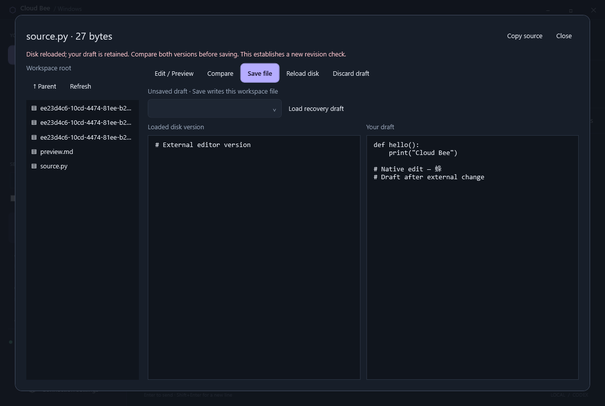

# Native Markdown and workspace files

Cloud Bee renders Markdown in conversations and Council answers using native WPF
documents. Text remains selectable. **Copy source** preserves the message's
Markdown syntax. Tool output keeps its existing plain-text expander.

Supported presentation includes headings, emphasis, strikethrough, quotes,
numbered/bulleted/task lists, pipe tables, inline code, fenced code and links.
Code blocks have basic token coloring for Rust, C#, Python, JavaScript,
TypeScript, PowerShell and JSON. Other languages display as plain code. This is
token coloring, not a language server or full editor. Heading anchors use GitHub
style identifiers.

HTML displays as text. Images display a placeholder; remote images, styles,
scripts, embeds and diagrams are not loaded or executed. Web links open the
default browser only when clicked. Links with credentials, UNC network paths,
script/data URLs and custom application protocols are inactive.

## File browser and links

Select a conversation, then **Workspace files**. Browse folders, use **Parent**
or **Refresh**, and select a UTF-8 text file. Markdown renders in the same native
viewer; supported source files receive token coloring. Select **Edit / Preview**
to edit the source and **Compare** to review the loaded disk version beside the draft.
Copy source retains the downloaded text. It does not send file contents to a
model or change Chat/Work permissions.

Markdown file links open this panel inside Cloud Bee. Relative paths are resolved
from the conversation workspace, or from the containing preview document.
Absolute local paths must stay inside that workspace. `#L12` and `:12` suffixes
select a source line in plain-text view; Markdown heading fragments navigate to
the rendered heading. Council links retain the answering model's session identity,
so they use that model's workspace rather than whichever tab is selected.

The existing authenticated Core API serves Windows previews:

- `GET /v1/bee/files/{session_id}/list?path=relative/folder`
- `GET /v1/bee/files/{session_id}/preview?path=relative/file.md`
- `POST /v1/bee/files/{session_id}/save`
- `GET /v1/bee/files/{session_id}/history?path=relative/file.md`
- `GET /v1/bee/files/{session_id}/saves/{request_id}`

Both Bee and raw native sessions are supported, including saved sessions.
The API accepts only normal relative paths, rejecting traversal, absolute paths,
Windows devices, alternate data streams and ambiguous trailing dots/spaces.
Directory handles constrain opens below the selected workspace; junctions that
lead outside it are rejected. Reparse-point workspace roots are unavailable.
These routes are Windows-only and preserve Core's Linux execution boundary.

Previews accept regular UTF-8 files up to 256 KiB. Binary files, PDF/image viewing,
uploads/downloads, file creation/deletion and full editor integrations are still pending. A directory listing is limited
to 500 immediate entries. Rendered content is limited to 96,000 characters and
10,000 document elements, with bounded nesting and highlighting work. A limit
notice is displayed when content cannot be fully rendered. Copy source keeps the
complete downloaded text within the API size limit.

No SQL migration, background model call or additional service is introduced.
Workspace permissions and the Windows user's access still apply; previews do
not provide a separate account sandbox.

## Saving and recovery

**Save file** explicitly writes the existing workspace file. It requires the
SHA-256 revision returned when the contents were loaded. Core opens the file
exclusively, checks that revision, persists the previous and proposed contents
in its private state directory, and writes through the same file handle. A
changed revision, busy/read-only file, hard link, outside junction or unsupported
file is rejected. File identity and ACLs are retained. Chat remains tool-free;
these are user-initiated editor actions, not model tool calls.

**Reload disk** retains your draft and shows the current disk contents beside
it. Review both versions before saving again. **Discard draft** explicitly
returns to disk contents. A dirty draft blocks switching files; closing the
panel retains it. Drafts and immutable pending save requests are saved in a
connection-specific `.files.json` beside the desktop outbox. Opening/reconnecting
restores them without sending a write. An unconfirmed save makes the editor
read-only; **Retry save** sends the identical request. A saved receipt is returned
without overwriting any later external edit. **Reload disk** explicitly checks
that request's receipt and starts a new revision comparison.

Core keeps before/after recovery text for up to ten completed saves per file
and 200 completed saves overall. Older hash receipts remain for duplicate
protection; uncertain records retain their recovery text. **Load recovery draft**
copies previous contents into the editor. It does not write disk until you choose
Save file. These copies are local private state, not an encrypted backup service.

The in-place project write is **not atomic across a crash or power loss**. An
interrupted write may leave partial contents. On restart, prepared journals are
marked `unknown_after_restart`; Core never replays them automatically. Reload
disk, review the retained recovery copy and explicitly save the desired contents.
If a retry finds the complete proposed bytes already on disk, it can confirm the
receipt without writing again. Exclusive Windows sharing guards ordinary file
operations; it does not prevent writes through a previously mapped memory view
or hardware/filesystem failures.

UTF-8 BOMs are preserved. The GUI preserves uniform CRLF or LF line endings;
mixed endings and bare CR normalize to LF. Edits including a BOM remain bounded
to 256 KiB. There is no autosave to project files, language server, merge engine,
file watcher or Monaco plugin compatibility yet.

Save JSON contains `request_id`, `path`, `expected_revision`, `text` (without the
transport BOM), optional `bom` (defaults to preserving disk's BOM), and
`authorize_write: true`. Reusing a request ID with different
content is rejected. The preview API reports `revision`, `bom` and `newline`;
capabilities report `workspace_file_preview` and `workspace_file_editing` on Windows.

## Validation and dependencies

`tests/files_fixture.py`, invoked by `tests/windows_extensions.py`, exercises
disposable Unicode files, UTF-8 BOMs, size/binary limits, authentication, unknown
sessions, device/stream/traversal rejection and an actual junction escape attempt.
It also checks explicit save authorization, revisions, BOMs, lost-receipt retries,
external edits, busy handles, hard links, backup retention and reconstructed
partial/completed crash journal states across a real Core restart.
The WPF smoke suite renders Markdown tables/code, clicks an actual file hyperlink,
checks its selected source line, verifies heading anchors and canonical Windows
paths, and checks Council workspace identity and unsafe link schemes. The editor
suite exercises dropped save responses, immutable retry, conflict comparison,
recovery drafts and reconnect persistence against disposable workspace files.

Markdown uses pinned [Markdig 1.4.1](https://www.nuget.org/packages/Markdig), parsed
to an AST and rendered directly to WPF. File access uses the existing
[cap-std directory API](https://docs.rs/cap-std/4.0.3/cap_std/fs/struct.Dir.html).
Revision hashes use [sha2](https://docs.rs/sha2/0.10.9/sha2/).
The portable package includes Markdig's upstream license in
`THIRD-PARTY-NOTICES.txt`.

