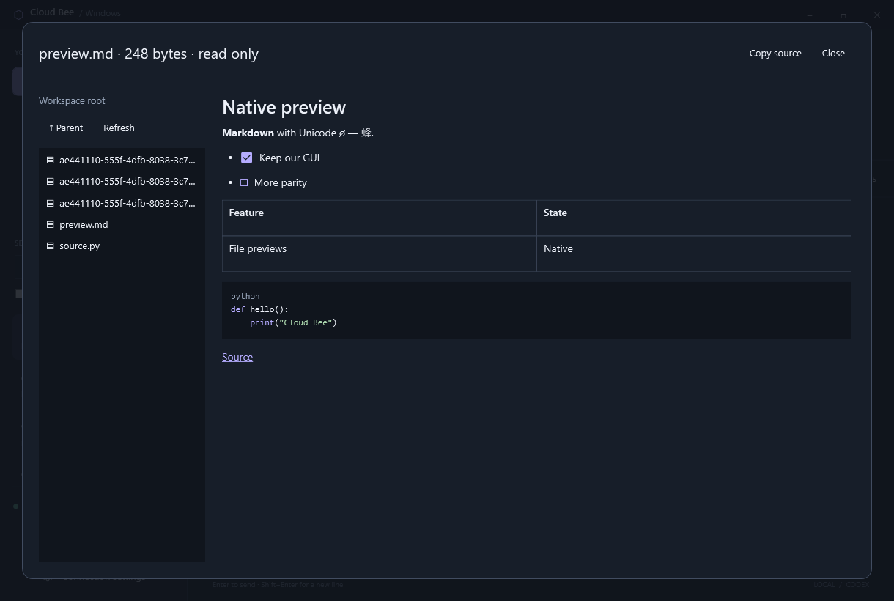

# Native Markdown and workspace file previews

Cloud Bee renders Markdown in conversations and Council answers using native WPF
documents. Text remains selectable. **Copy source** preserves the message's
Markdown syntax. Tool output keeps its existing plain-text expander.

Supported presentation includes headings, emphasis, strikethrough, quotes,
numbered/bulleted/task lists, pipe tables, inline code, fenced code and links.
Code blocks have basic token coloring for Rust, C#, Python, JavaScript,
TypeScript, PowerShell and JSON. Other languages display as plain code. This is
token coloring, not a language server or full editor. Heading anchors use GitHub
style identifiers.

HTML displays as text. Images display a placeholder; remote images, styles,
scripts, embeds and diagrams are not loaded or executed. Web links open the
default browser only when clicked. Links with credentials, UNC network paths,
script/data URLs and custom application protocols are inactive.

## File browser and links

Select a conversation, then **Workspace files**. Browse folders, use **Parent**
or **Refresh**, and select a UTF-8 text file. Markdown renders in the same native
viewer; supported source files receive token coloring. The panel is read only.
Copy source retains the downloaded text. It does not send file contents to a
model or change Chat/Work permissions.

Markdown file links open this panel inside Cloud Bee. Relative paths are resolved
from the conversation workspace, or from the containing preview document.
Absolute local paths must stay inside that workspace. `#L12` and `:12` suffixes
select a source line in plain-text view; Markdown heading fragments navigate to
the rendered heading. Council links retain the answering model's session identity,
so they use that model's workspace rather than whichever tab is selected.

The existing authenticated Core API serves Windows previews:

- `GET /v1/bee/files/{session_id}/list?path=relative/folder`
- `GET /v1/bee/files/{session_id}/preview?path=relative/file.md`

Both Bee and raw native sessions are supported, including saved sessions.
The API accepts only normal relative paths, rejecting traversal, absolute paths,
Windows devices, alternate data streams and ambiguous trailing dots/spaces.
Directory handles constrain opens below the selected workspace; junctions that
lead outside it are rejected. Reparse-point workspace roots are unavailable.
These routes are Windows-only and preserve Core's Linux execution boundary.

Previews accept regular UTF-8 files up to 256 KiB. Binary files, PDF/image viewing,
uploads/downloads and editing are still pending. A directory listing is limited
to 500 immediate entries. Rendered content is limited to 96,000 characters and
10,000 document elements, with bounded nesting and highlighting work. A limit
notice is displayed when content cannot be fully rendered. Copy source keeps the
complete downloaded text within the API size limit.

No SQL migration, background model call or additional service is introduced.
Workspace permissions and the Windows user's access still apply; previews do
not provide a separate account sandbox.

## Validation and dependencies

`tests/files_fixture.py`, invoked by `tests/windows_extensions.py`, exercises
disposable Unicode files, UTF-8 BOMs, size/binary limits, authentication, unknown
sessions, device/stream/traversal rejection and an actual junction escape attempt.
The WPF smoke suite renders Markdown tables/code, clicks an actual file hyperlink,
checks its selected source line, verifies heading anchors and canonical Windows
paths, and checks Council workspace identity and unsafe link schemes.

Markdown uses pinned [Markdig 1.4.1](https://www.nuget.org/packages/Markdig), parsed
to an AST and rendered directly to WPF. File access uses the existing
[cap-std directory API](https://docs.rs/cap-std/4.0.3/cap_std/fs/struct.Dir.html).
The portable package includes Markdig's upstream license in
`THIRD-PARTY-NOTICES.txt`.

