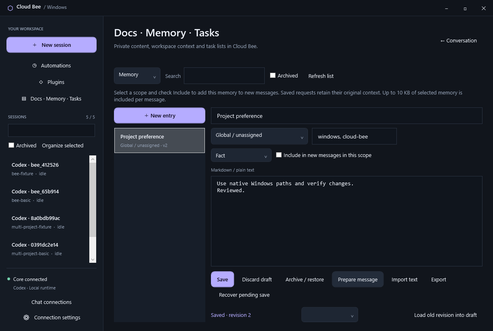

# Docs, Memory, Tasks and conversation organization

Select **Docs · Memory · Tasks** in Cloud Bee's sidebar. Choose a type, then
**Install / enable** on first use. These native ports are opt-in, matching the
original official plugins. They keep our WPF GUI and use the existing Rust Core.
They implement the subset described below; the full original feature checklist
is [cloudroom-feature-parity.md](cloudroom-feature-parity.md).

The launcher also repairs a missing saved Codex executable after a Codex app
update by rediscovering the installed binary. It preserves the existing token,
account home, model, workspace and history configuration.

## Private library

Create an entry, choose an optional registered workspace, add comma-separated
tags and save. Docs edit Markdown as text. Import reads a UTF-8 file you select;
Export writes the current text to a file you select. The API does not accept
arbitrary filesystem paths for import/export. Vault sync and rich previews are
pending.

Tasks support the original `backlog`, `todo`, `in_progress`, `in_review`, `done`
and `canceled` statuses. **Prepare message** appends an entry to the selected
conversation draft for review; it makes no provider call or permission change.
Project boards, comments, attachments, PRs and delegated agents are pending.

Memory supports facts, preferences, decisions, procedures, episodes and
references. **Global / unassigned** memory applies to all Bee workspaces; choosing
a workspace limits it to that registered folder. Check **Include in new messages
in this scope** and save to authorize inclusion. The API independently requires
`authorize_context: true` whenever saving an included memory. Enabling Memory
alone does not select any entries. Messages beginning with `/` are unchanged.

New Bee Chat/Work messages and agent automation runs snapshot matching selected
memories alongside custom instructions. Existing accepted requests and retries
retain their original execution context. Disabling/uninstalling Memory stops
future injection and retains data. Historical Chat turns retain already submitted
context. Saved memories cannot grant tools or bypass Work authorization. Legacy
raw Core prompts do not receive this hook.

The memory budget is 10,000 UTF-8 bytes per message, with entries considered in
stable identity order. An entry that would exceed the budget is skipped; shorter
later entries can still fit. Keep selected memories concise and avoid selecting
more than the budget. Each included memory body is limited to 6,000 bytes.
The original importance ranking and agent memory catalog are pending.

Search filters the current type's titles, bodies and tags. **Archive / restore**
preserves data; archived memory is excluded from new context. The **Archived**
filter makes entries recoverable. Updating a saved entry retains its last five
content revisions. Choose a revision and **Load old revision into draft**, review,
then save. It does not silently overwrite the current revision.

Edits require the current revision; stale writes fail with a reload message.
Mutation IDs replay the original result on retry and reject changed payloads.
Unsent drafts and pending library saves are kept next to Core settings in the
connection-specific `.library.json` file. A restored draft is never sent
automatically. **Recover pending save** restores the immutable payload so Save
can retry it unchanged. Save/discard before changing entries or type. Navigating
to a conversation preserves the library editor's text.

Limits: 200 entries including archived records, 160-character titles, 48 KiB
bodies, up to 16 tags of 40 characters, and five retained content revisions.
These are bounded native storage limits, not original vault compatibility.

## Conversation organization

Select a conversation and choose **Organize selected** in the sidebar. Save a
title, optional collection, pin and archive state. Pins sort first; collections
sort together and are searchable along with titles, models and folder names.
Search does not yet index full transcripts. **Archived** shows hidden
conversations so they can be restored. Archiving changes sidebar organization
only: it does not close a conversation, interrupt Work, move files or change
Council membership. Collections are organizational labels, not Git projects.
Names, pins, collections and archive state survive reconnect/Core restart.

## API, storage and acceptance

Native Windows routes use the existing authenticated, loopback-only API:

- `GET /v1/bee/library` returns content summaries, plugin state and workspaces.
- `POST /v1/bee/library` creates a typed entry with an immutable request ID.
- `GET /v1/bee/library/{id}` returns its content and retained revisions.
- `POST /v1/bee/library/{id}/update|archive|restore` requires the current revision.
- `GET /v1/bee/threads` returns saved sidebar organization.
- `POST /v1/bee/threads/{id}/organize` updates an existing conversation's
  organization with a revision and request ID.

Data remains in private `extensions/state.json`; no SQL migration or original
SQLite import is performed. Uninstall retains content and revision history.
Workspace validation reads existing registrations; unknown IDs cannot create
folders. Import/export are explicit GUI file selections.

`tests/windows_extensions.py` exercises the disposable library contracts,
including authorization, workspace separation, immutable memory context,
idempotency, conflicts, revisions, retention, restart and archive while Chat
is running. `tests/windows_gui.py` exercises the actual WPF pages and organization,
draft restoration and reconnect. It drops a read connection to check recovery
and a prompt receipt to check deliberate write retry. Read requests get one
transport retry; writes retain their existing explicit retry behavior.

The native ComboBox template uses Microsoft's documented
[selection content template contract](https://learn.microsoft.com/en-us/dotnet/api/system.windows.controls.combobox.selectionboxitemtemplate?view=windowsdesktop-10.0)
so workspace and revision labels display correctly.

